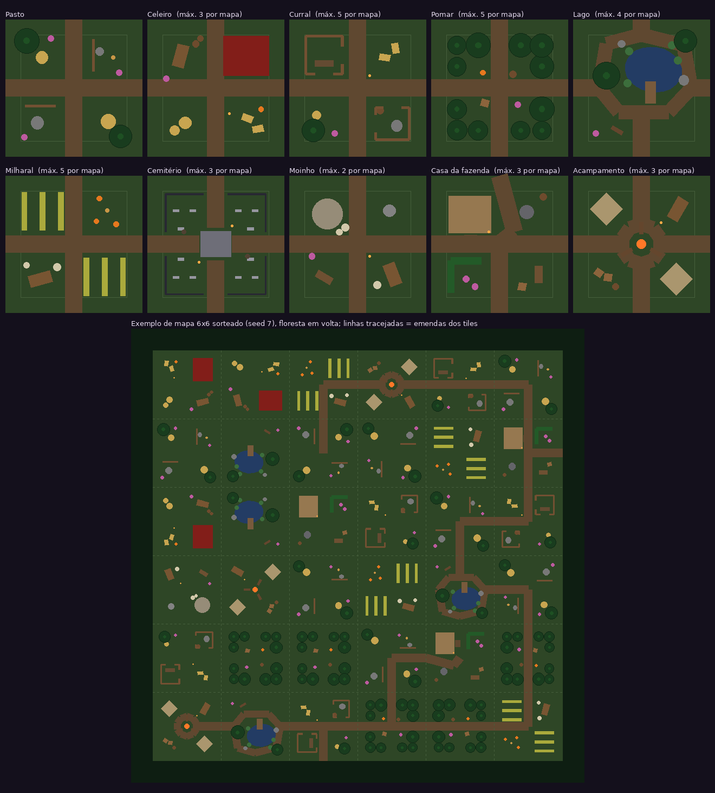

# Mapa procedural da Fazenda

Decidido com o criador (nov/2026). Todos os números são **[PROTÓTIPO]**.

A cada partida a Fazenda é montada de novo a partir de **10 tiles** (blocos) de 18 × 18 m, numa grade de
**6 × 6** (108 m de lado), cercada por floresta. Com 10 tiles × 8 posições (4 giros × espelhado) em 36 vagas,
dá para jogar a vida inteira sem repetir um mapa.



## Por que qualquer tile encaixa em qualquer outro

Todo tile segue a mesma **regra de borda**:

1. **Faixa livre de 2 m** em cada borda: nada que bloqueia (cerca, celeiro, árvore) encosta na borda.
   Entre dois tiles sempre sobram ≥ 4 m para passar — nunca existe barreira entre tiles.
2. **Ponta de estrada no meio de cada lado.** O gerador sorteia uma **rede de estradas** (uma árvore
   aleatória que liga alguns pontos do mapa e sai para a floresta em 2 lugares) e só desenha as pontas
   que a rede usa. Por isso as estradas sempre se ligam e o mapa não vira um tabuleiro de quarteirões.
3. **Sem bolsões:** todo lugar livre do tile é alcançável a pé, **medido com o lobisomem** (o maior
   personagem, raio ~0,8 m).

O `build_farm_tiles.py` confere as 3 regras e **não grava** o JSON se algum tile quebrar uma delas.

## Os 10 tiles

| Tile | Máx. por mapa | O que tem |
|---|---|---|
| Pasto | sem limite | aberto: feno, pedras, espantalho, pedaços de cerca |
| Celeiro | 3 | celeiro grande, feno, carroça, barris, lampião |
| Curral | 5 | dois cercados com aberturas, cocho |
| Pomar | 5 | 12 árvores em linhas, clareira no meio |
| Lago | 4 | lago raso (dá para andar), píer, juncos, estrada em volta |
| Milharal | 5 | fileiras de milho altas (bloqueiam tiro) com corredores |
| Cemitério | 3 | grade de ferro com 4 portões, cripta, túmulos, árvores secas |
| Moinho | 2 | moinho com pás girando, sacos, mó, lenha |
| Casa da fazenda | 3 | casa com janelas acesas, poço, cerca viva |
| Acampamento | 3 | fogueira (luz), barracas, carroça, caixotes |

Os limites existem só para não sair um mapa com 8 celeiros. **Não há tile especial** de entrada ou saída:

- **você** nasce num ponto livre sorteado;
- o **portal de extração** fica a 40–80% do lado do mapa de você (43–86 m), num lugar com espaço em volta;
- o **invasor** aparece a 22–34 m de onde você está (escondido na névoa, a poucos segundos de distância).

Uma **seta roxa** na borda da tela aponta para o portal quando ele está fora da tela.

## Seed (número do mapa)

O canto superior direito do HUD mostra **"Mapa nº …"**. O mesmo número sempre gera o mesmo mapa:

- para **repetir um mapa** (bug, teste): coloque o número em `GameBootstrap → Settings → Farm Seed`;
- `Farm Seed = 0` (padrão) = mapa novo a cada partida.

Isso também vai ser a base do multiplayer: o servidor manda o seed e todos montam o mesmo mapa.

## Configurações (Inspector do GameBootstrap → Settings)

| Campo | Padrão | O que faz |
|---|---|---|
| Farm Grid Size | 6 | tiles por lado (6 = 6×6) |
| Farm Seed | 0 | 0 = mapa novo; outro número = sempre o mesmo mapa |
| Farm Merge Meshes | ligado | junta as peças paradas em malhas grandes (mais FPS). Desligue se algo aparecer errado |
| Sheep Per Tile | 1 | ovelhas por tile (36); vale o maior entre isso e Sheep Count |
| Arena Half Size | — | agora é **calculado** pela grade (54 m); o valor do Inspector é ignorado |

## Trocar os modelos (sem mexer em código)

As peças hoje são formas simples. Para trocar uma peça por um modelo de verdade, crie um prefab em
`Assets/VampWolfs/Resources/VampWolfs/FarmPieces/<tipo>.prefab`, por exemplo `barn.prefab`, `tree.prefab`
ou `fence.prefab`. O jogo usa o prefab no lugar da forma simples, em todos os tiles.

- **Pivô no chão, no centro da peça, de frente para +Z** (como a peça simples).
- **Tamanho:** o mesmo da tabela abaixo (largura × profundidade). O gerador mede o mapa por esses números.
- **Peças compridas** (`fence`, `ironfence`, `hedge`, `croprow`, `road`): o prefab é **um pedaço de 2 m ao longo de +Z**,
  repetido no comprimento.
- **Colisores dentro do prefab são desligados.** A colisão vem sempre do `farm_tiles.json`, para um modelo novo
  nunca fechar um caminho sem querer. Se o modelo ficar maior, mude o tamanho no `build_farm_tiles.py`.

| Tipo | Tamanho no chão (m) | Bloqueia |
|---|---|---|
| barn | 8 × 7 | sim |
| house | 7 × 6 | sim |
| crypt | 4 × 3,4 | sim |
| tent | 3 × 3 | sim |
| windmill | raio 2 (as pás são outro objeto e giram) | sim |
| well | raio 0,9 | sim |
| haystack | raio 0,8 | sim |
| bale | 1,4 × 0,9 | sim |
| tree / deadtree | raio 0,35 / 0,3 (só o tronco) | sim |
| rock | raio 0,6 | sim |
| crate | 1 × 1 | sim |
| barrel | raio 0,45 | sim |
| cart | 1,6 × 3 | sim |
| woodpile | 2,2 × 1 | sim |
| trough | 0,8 × 2,4 | sim |
| fence / ironfence / hedge / croprow | 0,3 / 0,2 / 0,9 / 0,7 de largura | sim |
| grave | 0,8 × 0,3 | sim |
| lantern / scarecrow / millstone / sacks / log | pequenos | sim |
| road, pond, dock, campfire, reeds, flowers, pumpkin | — | não (decoração) |

## Criar ou mudar tiles

Tudo em `Tools/Data/build_farm_tiles.py` (uma função por tile, com coordenadas de −9 a 9).

```
python3 Tools/Data/build_farm_tiles.py Assets/VampWolfs/Resources/VampWolfs/farm_tiles.json docs/img/mapa_tiles.png
```

O script mostra quanto de cada tile fica livre, aponta o erro exato (peça na faixa de borda, ponta de estrada
faltando, bolsão fechado com a posição) e desenha a prévia. Para adicionar um 11º tile, crie a função e
coloque-a na lista `TILES`.

## Onde está no código

- `Scripts/World/FarmTileCatalog.cs`: lê o `farm_tiles.json`.
- `Scripts/World/FarmPlan.cs`: o mapa como dados puros (sorteio dos tiles, giro/espelho, estradas, peças). Testável fora do Unity.
- `Scripts/World/WalkGrid.cs`: onde dá para andar (células de 25 cm), pontos de nascimento e o caminho A* da IA.
- `Scripts/World/FarmGenerator.cs`: monta a cena (peças, colisores, decoração, floresta, paredes invisíveis).
- `Scripts/World/FarmPieces.cs`: o visual de cada peça (formas simples ou o seu prefab).
- `Scripts/World/FarmBuilder.cs`: luz da lua, névoa roxa e o seed.
- A IA (`AI/WerewolfAI.cs`) vai em linha reta quando enxerga o alvo e segue o caminho A* quando há obstáculo no meio.
